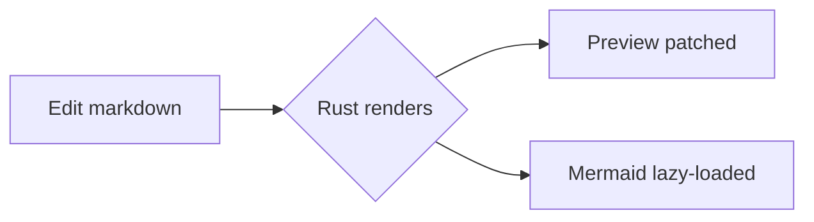

# Sample workspace

Open this folder in MDelight to try it out. See [the guide](guide/intro.md).

- [x] Split code / preview with scroll sync
- [x] Fuzzy file search (`Ctrl+P`)
- [ ] Your feature here

| Key | Action |
|-----|--------|
| Ctrl+P | Quick open |
| Ctrl+Shift+F | Search in files |
| Ctrl+1/2/3 | Code / Split / Preview |

